# Лабораторная работа №2. Облачные вычислительные сервисы. Amazon EC2

| | |
|---|---|
| **Студент** | Noroc Eugeniu |
| **Группа** | IA2404 |
| **Специальность** | Informatică aplicată |
| **Email** | eukoron@gmail.com |
| **Уровень** | Продвинутый |
| **Регион AWS** | eu-north-1 (Stockholm) |
| **Приложение** | TimeCapsule - open_capsules_php_functional |
| **Вариант деплоя** | A - команды выполняются на сервере вручную |
| **Репозиторий** | https://github.com/eugeniu-noroc-cloud/timecapsule |

> Работа выполнялась в регионе **eu-north-1 (Stockholm)** вместо eu-central-1, все команды адаптированы под этот регион.

---

## Часть 1. Базовый уровень

### Задание 1. Подготовка аккаунта

Создан IAM-пользователь в группе `Admins` с политикой `AdministratorAccess`, вход в консоль выполняется под ним. Настроен бюджет с нулевым порогом.

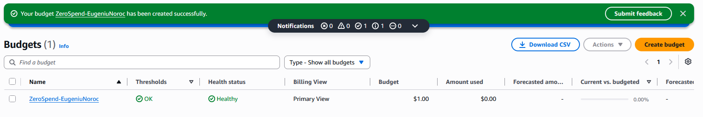
*Бюджет ZeroSpend в списке Budgets.*

**Что разрешает политика AdministratorAccess? Почему для повседневной работы нельзя использовать root?**
AdministratorAccess разрешает любые действия (`Action: *`) над любыми ресурсами (`Resource: *`) во всех сервисах AWS. Права root ничем не ограничиваются, и только root может закрыть аккаунт, сменить email и платёжные данные. Если данные root утекут, аккаунт потерян полностью. Права IAM-пользователя можно ограничить или отозвать, а его действия видны отдельно. Поэтому root используется только для редких задач управления аккаунтом.

### Задание 2. Запуск экземпляра EC2

Запущен экземпляр `webserver` (Amazon Linux 2023, t3.micro) с Security Group `webserver-sg` (SSH с моего IP, HTTP отовсюду) и скриптом User data, устанавливающим nginx.

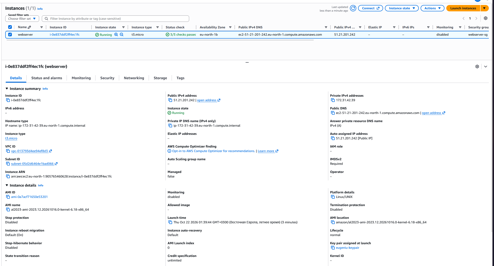
*Экземпляр webserver в состоянии Running, 3/3 проверок пройдено.*

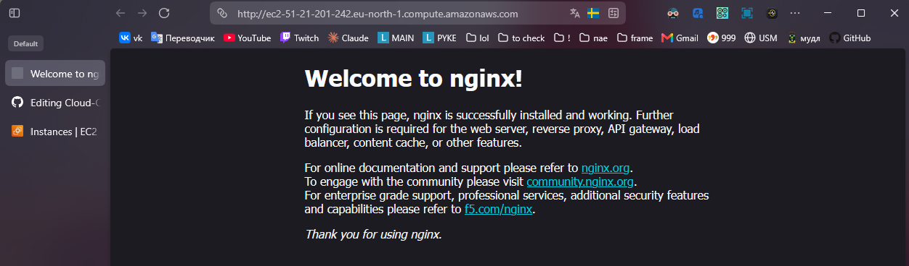
*Приветственная страница nginx по публичному IP экземпляра.*

**Что такое User data и когда выполняется этот скрипт? Выполнится ли он повторно после перезагрузки?**
User data - это скрипт, который передаётся экземпляру при запуске. Его выполняет cloud-init от имени root при первой загрузке экземпляра. После перезагрузки или Stop/Start он повторно не выполняется, если специально не настроить его на каждый запуск.

### Задание 3. Мониторинг и диагностика

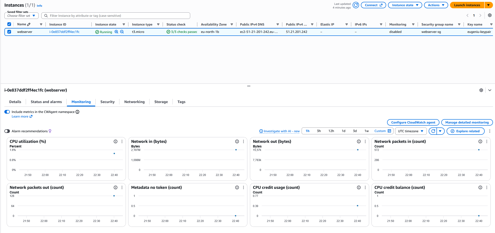
*Метрики CloudWatch на вкладке Monitoring.*

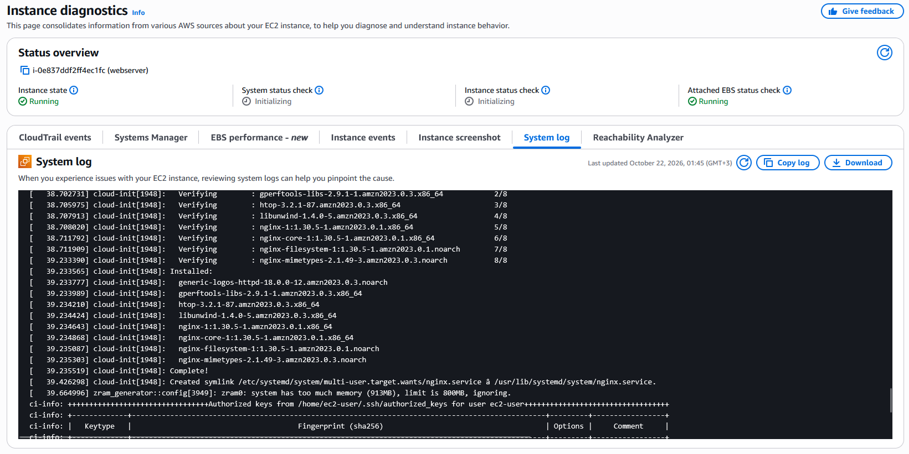
*Фрагмент System log с установкой nginx из User data.*

**Какая проверка укажет на проблему, которую можете исправить вы, а какая - на проблему на стороне AWS?**
System status check отражает проблемы инфраструктуры AWS: физического сервера, сети, питания. Их решает AWS, а пользователь может только сделать Stop/Start, чтобы экземпляр переехал на другой хост. Instance status check указывает на проблемы внутри самой виртуальной машины (не загрузилась ОС, ошибка в сетевой конфигурации, переполнен диск), и исправлять их должен владелец экземпляра.

**В каких случаях стоит включать детальный мониторинг?**
Когда важно быстро реагировать на изменения нагрузки: для автомасштабирования по CPU, для production-сервисов, где пятиминутная задержка метрик слишком велика, и при поиске коротких пиков нагрузки во время отладки производительности. Для учебного сервера достаточно базового мониторинга.

### Задание 4. Подключение по SSH

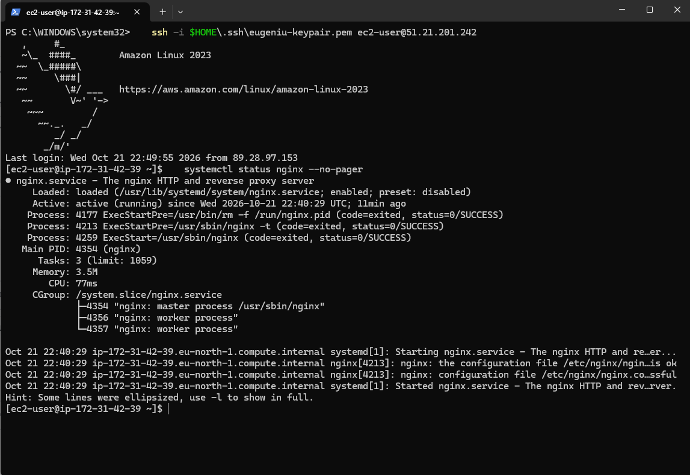
*Успешное подключение по SSH и вывод `systemctl status nginx` (active (running)).*

**Почему для входа на экземпляр EC2 используется ключ, а не пароль?**
Вход по ключу основан на асимметричной криптографии: публичный ключ AWS кладёт на сервер в `~/.ssh/authorized_keys`, а приватный никогда не покидает компьютер пользователя. Такой ключ невозможно подобрать перебором, в отличие от пароля, и его нельзя перехватить при входе. Поэтому в образах Amazon Linux вход по паролю отключён по умолчанию.

### Задание 5. Статический сайт

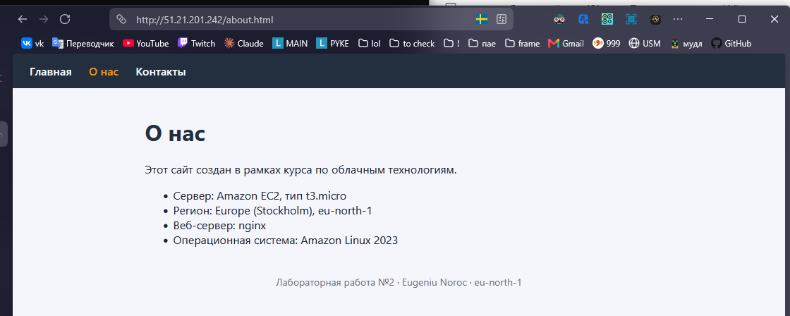
*Собственный сайт из трёх страниц по публичному IP.*

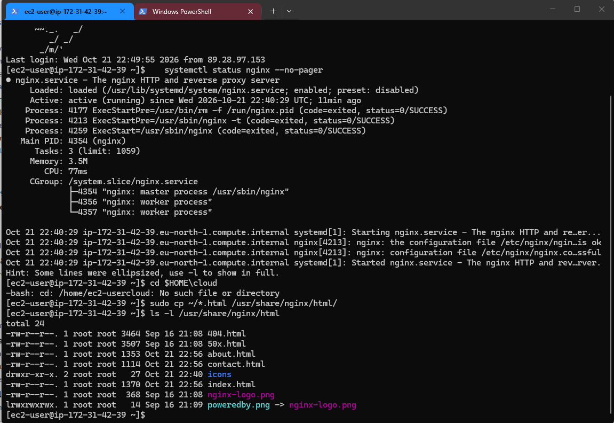
*Вывод `ls -l /usr/share/nginx/html` с файлами index.html, about.html, contact.html.*

**Что делает команда scp и чем она похожа на ssh?**
scp копирует файлы между компьютерами по зашифрованному протоколу SSH. Она использует тот же ключ (`-i`), того же пользователя и тот же формат адреса `user@host`, что и ssh. Разница в том, что scp передаёт файлы, а ssh открывает интерактивную сессию на сервере.

### Задание 6. Остановка экземпляра через AWS CLI

```bash
aws ec2 stop-instances --instance-ids <ID-экземпляра> --region eu-north-1
```

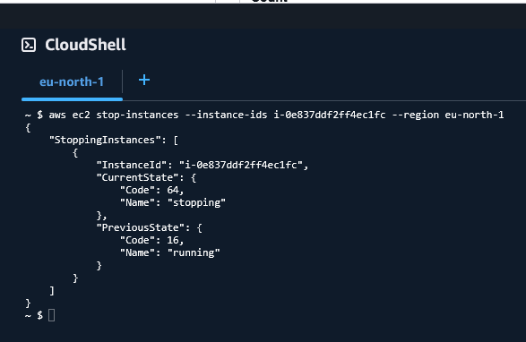  
*Команда `aws ec2 stop-instances` и её вывод (переход в состояние stopping).*

**Чем Stop отличается от Terminate? За что вы продолжаете платить, пока экземпляр остановлен?**
Stop выключает виртуальную машину, но сохраняет её корневой том EBS и данные на нём, поэтому экземпляр можно запустить снова (публичный IP при этом сменится). Terminate удаляет экземпляр безвозвратно, а корневой том EBS по умолчанию удаляется вместе с ним. Пока экземпляр остановлен, оплата за вычисления не начисляется, но продолжается оплата хранения томов EBS, снимков и выделенных Elastic IP, если они есть.

---

## Часть 2. Продвинутый уровень

### Задание 7. Организация и репозиторий на GitHub

Создана организация `eugeniu-noroc-cloud` и публичный репозиторий `timecapsule`, в который загружен код приложения.

**Почему папка vendor/ и файл .env не попали в репозиторий?**
Оба пути указаны в `.gitignore`. Папка `vendor/` содержит сторонние библиотеки, которые занимают много места и точно воспроизводятся командой `composer install` по файлу `composer.lock`. Файл `.env` содержит пароли и настройки конкретного окружения, поэтому ему не место в общем, тем более публичном, репозитории.

### Задание 8. Подготовка сервера

**Почему мы устанавливаем эти пакеты вручную, а не добавляем их в User data?**
User data выполняется только при первом запуске экземпляра, а наш экземпляр уже был запущен в Части 1, поэтому изменение User data ни на что не повлияло бы. Кроме того, ручная установка позволяет увидеть каждый шаг и сразу заметить ошибки. На практике для новых серверов такие шаги автоматизируют через User data или собственный AMI.

### Задание 9. База данных PostgreSQL

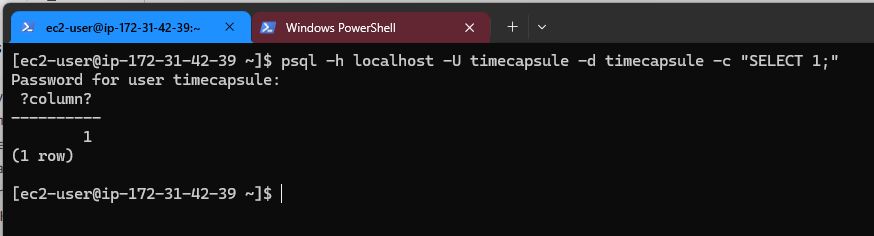  
*Успешное подключение по паролю: `psql -h localhost -U timecapsule -d timecapsule -c "SELECT 1;"`.*

### Задание 10. Развёртывание кода приложения на сервере

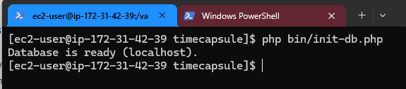  
*Вывод `php bin/init-db.php`: Database is ready.*

**Почему пароль к базе данных хранится в файле .env на сервере, а не в коде? Почему публичный репозиторий безопасен для этого приложения?**
Код в репозитории может прочитать любой человек, поэтому секреты отделены от кода и хранятся только на сервере, к тому же они различаются в разных окружениях. Публичный репозиторий безопасен, потому что в нём нет ни паролей, ни ключей. База данных при этом слушает только localhost, и порт 5432 не открыт в Security Group, так что знание кода не даёт доступа к данным.

### Задание 11. Настройка PHP-FPM и nginx

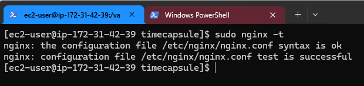  
*Проверка конфигурации: `sudo nginx -t` - syntax is ok, test is successful.*

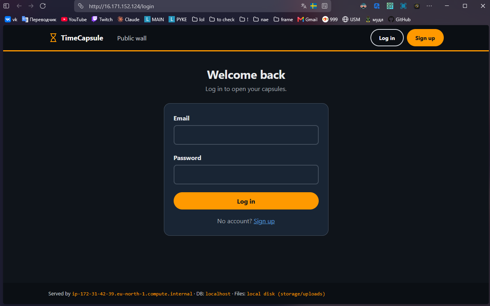  
*Страница входа TimeCapsule по публичному IP.*

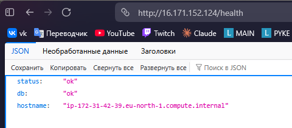  
*Ответ `/health`: `{"status":"ok","db":"ok",...}`.*

### Задание 12. Обновление приложения

Выбран вариант A: новая версия выпускается вручную. После подключения к серверу по SSH выполняются команды:

```bash
cd /var/www/timecapsule
git pull
composer install --no-dev --optimize-autoloader
php bin/init-db.php
sudo systemctl reload php-fpm
```

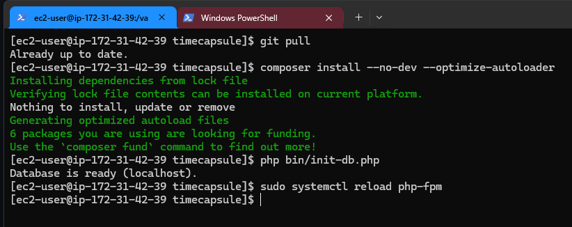  
*Выполнение команд обновления на сервере.*

**Что может увидеть посетитель во время git pull? Что случится, если после git pull не выполнится composer install?**
Во время `git pull` часть файлов уже новая, а часть ещё старая, поэтому посетитель может получить ошибку 500 или страницу, собранную из разных версий кода. Если новая версия требует новой библиотеки, а `composer install` не выполнен, PHP не найдёт нужный класс, и все страницы, где он используется, будут падать с ошибкой 500.

### Задание 13. Новая версия, поломка и откат

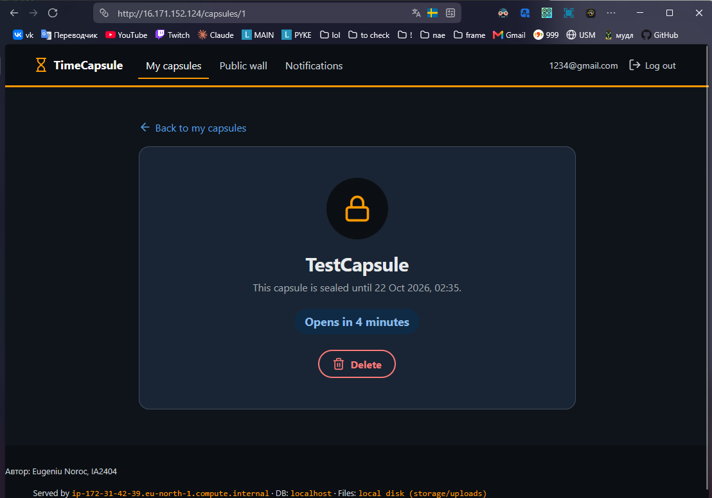  
*Новая версия: в подвале страницы отображается имя автора, ранее созданная капсула сохранилась.*

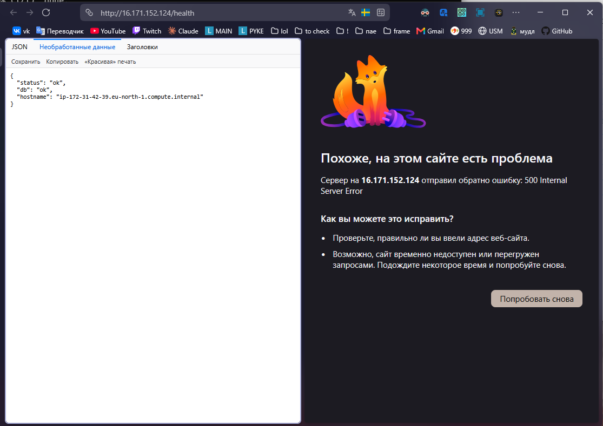  
*Ошибка 500 после деплоя версии с синтаксической ошибкой.*

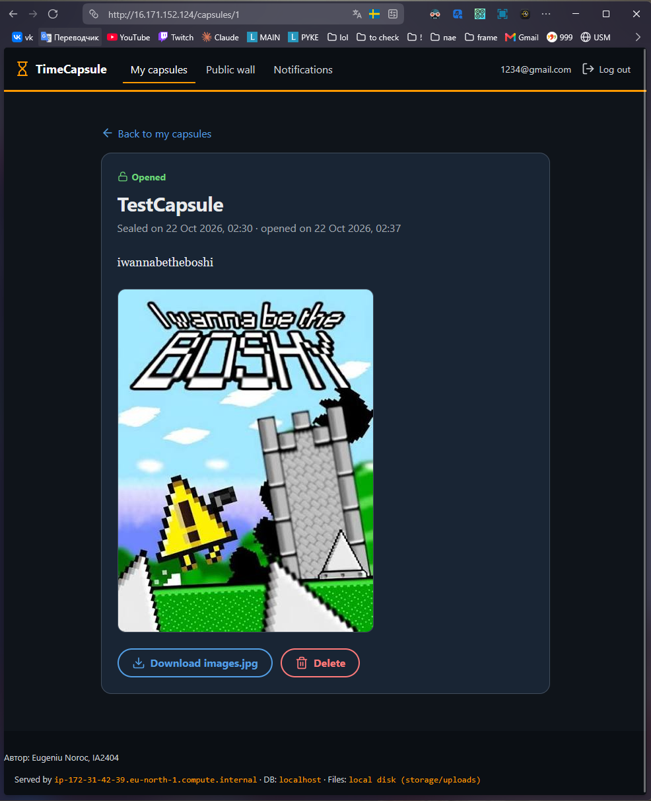  
*Сайт снова работает после `git revert` и повторного деплоя.*

**Почему /health отвечает ok, хотя главная страница не работает? Что проверяет этот адрес? Чего не хватает такой проверке?**
Маршрут `/health` не использует шаблон `views/layout.php`, поэтому ошибка в нём на этот маршрут не влияет. Он проверяет только, что PHP-FPM выполняет код и приложение может подключиться к базе данных. Такой проверке не хватает проверки реальных пользовательских страниц, например smoke-теста главной страницы после каждого деплоя.

**Сколько времени сайт был сломан? Из каких шагов сложилось это время? Как его сократить?**
Сайт был сломан около 2,5 минут: с 02:34:42 (деплой версии с ошибкой) до 02:37:11 (завершение повторного деплоя после отката). Это время сложилось из обнаружения ошибки в браузере, выполнения `git revert` и `git push` на своём компьютере, подключения к серверу и повторного выполнения команд деплоя вручную. Сократить его можно проверкой кода до деплоя (`php -l`, автотесты в CI), автоматической проверкой страниц сразу после деплоя с автоматическим откатом, а также хранением предыдущей версии на сервере, чтобы откат был просто переключением на неё.

### Задание 14. Архитектура и решение

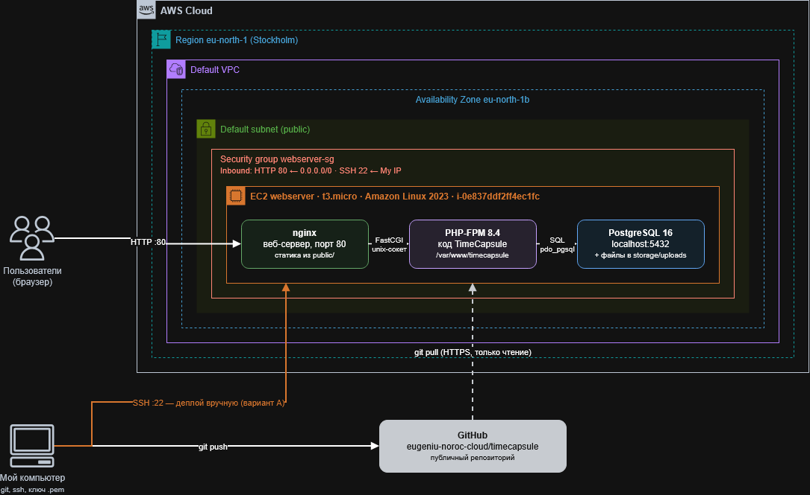  
*Схема развёртывания TimeCapsule на одном экземпляре EC2 в регионе eu-north-1.*

ADR: [docs/adr/0001-deploy-method.md](docs/adr/0001-deploy-method.md)  

---

## Ответы на контрольные вопросы

**1. Как проходит запрос от браузера до базы данных? Какую роль играет каждая программа?**
Запрос из браузера проходит через Security Group (порт 80) и попадает в nginx. Существующие статические файлы nginx отдаёт сам, а остальные запросы передаёт front controller `index.php` через unix-сокет в PHP-FPM. PHP-FPM выполняет код приложения, которое через драйвер `pdo_pgsql` обращается к PostgreSQL на localhost:5432. Готовый HTML возвращается по той же цепочке обратно в браузер.

**2. Почему сервер может скачивать код из репозитория, но не может отправлять в него изменения? Почему это правильно?**
Публичный репозиторий можно клонировать по HTTPS без авторизации, а для `git push` нужны учётные данные GitHub (токен или SSH-ключ), которых на сервере нет. Это соответствует принципу минимальных привилегий: серверу нужно только читать код. Даже если сервер взломают, злоумышленник не сможет изменить код в репозитории.

**3. Что произойдёт с загруженными файлами, если удалить экземпляр EC2? Как это связано с EBS?**
Загруженные файлы и база данных хранятся на корневом томе EBS экземпляра. У корневого тома по умолчанию установлен флаг DeleteOnTermination, поэтому при Terminate том и все данные на нём удаляются безвозвратно. При Stop том сохраняется. Чтобы не потерять данные, нужны снимки EBS или вынос файлов и базы в отдельные сервисы (S3, RDS).

**4. Что общего у deploy.sh или ручных команд с CI/CD? Чего ещё не хватает?**
Общее - сама последовательность шагов: взять код из репозитория, установить зависимости, применить изменения в базе и перезапустить приложение. CI/CD выполняет те же шаги. Не хватает автоматического запуска при `git push`, тестов и проверок перед деплоем, проверки после деплоя с автоматическим откатом, деплоя без простоя, а также истории и уведомлений о выпусках.

---

## Использованные источники

- Лекция 4 «Вычислительные сервисы. Amazon EC2 и machine identity», Hands-on 4.1–4.3
- [Документация Amazon EC2](https://docs.aws.amazon.com/ec2/)
- [Репозиторий msu-cloud-course/app-samples](https://github.com/msu-cloud-course/app-samples)
