# Лабораторная работа №3. Облачные сети. Amazon VPC

| | |
|---|---|
| **Студент** | Noroc Eugeniu |
| **Группа** | IA2404 |
| **Специальность** | Informatică aplicată |
| **Номер k** | 28 → X = 28 % 30 = **28** |
| **Уровень** | Продвинутый |
| **Регион AWS** | eu-north-1 (Stockholm), зоны eu-north-1a и eu-north-1b |
| **Вариант NAT Gateway** | A — создание и удаление в консоли |
| **Репозиторий** | https://github.com/eugeniu-noroc-cloud/timecapsule |

> Работа выполнялась в регионе **eu-north-1 (Stockholm)** вместо eu-central-1, как и ЛР2: образ сервера ЛР2 существует только в этом регионе. Зоны доступности eu-north-1a и eu-north-1b используются вместо eu-central-1a и eu-central-1b.

Все ресурсы созданы с тегами: `Name` по шаблону `timecapsule-dev-<роль>[-<зона>]`, `Project=timecapsule`, `Environment=dev`, `Owner=eugeniu-noroc-cloud`, `Lab=lab3`.

---

## Часть 1. Базовый уровень

### Задание 1. План адресов

VPC: `10.28.0.0/16`

| Подсеть | Зона доступности | Диапазон | Первый и последний адрес, доступный экземплярам | Сколько адресов доступно экземплярам |
|---|---|---|---|---|
| public-a | eu-north-1a | 10.28.0.0/24 | 10.28.0.4 – 10.28.0.254 | 251 |
| public-b | eu-north-1b | 10.28.1.0/24 | 10.28.1.4 – 10.28.1.254 | 251 |
| private-a | eu-north-1a | 10.28.10.0/24 | 10.28.10.4 – 10.28.10.254 | 251 |
| private-b | eu-north-1b | 10.28.11.0/24 | 10.28.11.4 – 10.28.11.254 | 251 |

**Почему доступных адресов не 256? Какие адреса занимает AWS? Сколько ещё подсетей /24 поместится в VPC?**
В подсети /24 всего 256 адресов, но AWS резервирует пять из них. В подсети 10.28.0.0/24 это: `10.28.0.0` — адрес самой сети; `10.28.0.1` — маршрутизатор VPC; `10.28.0.2` — DNS-сервер VPC; `10.28.0.3` — зарезервирован AWS на будущее; `10.28.0.255` — широковещательный адрес (в VPC broadcast не поддерживается, поэтому адрес просто не выдаётся). Экземплярам остаётся 256 − 5 = 251 адрес. VPC /16 вмещает 256 подсетей /24, четыре уже заняты, значит, поместится ещё 252.

### Задание 2. VPC и подсети

**Является ли подсеть public-a сейчас публичной? Почему?**
Нет. Подсеть становится публичной не из-за названия, а из-за маршрута `0.0.0.0/0` в Internet Gateway в её таблице маршрутов. Сразу после создания у VPC нет Internet Gateway, а подсеть связана с основной таблицей, где есть только локальный маршрут, поэтому выйти в интернет из неё нельзя.

### Задание 3. Internet Gateway и таблицы маршрутов

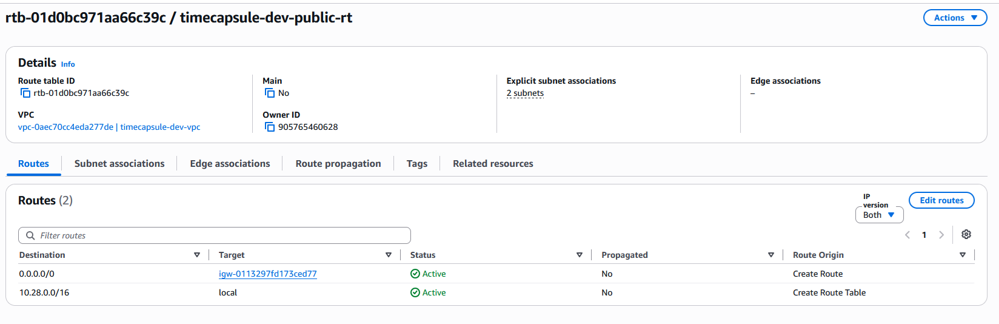  
*public-rt: локальный маршрут 10.28.0.0/16 и маршрут 0.0.0.0/0 в timecapsule-dev-igw.*

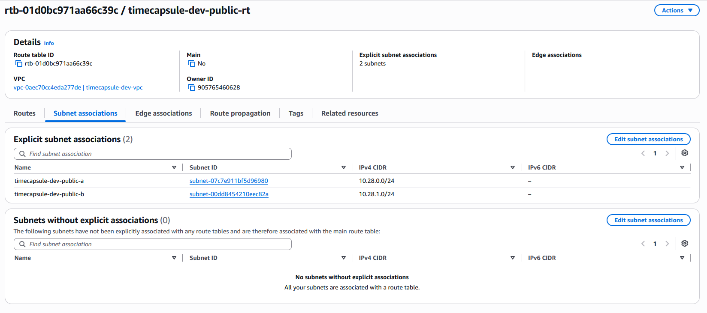  
*public-rt связана с подсетями public-a и public-b.*

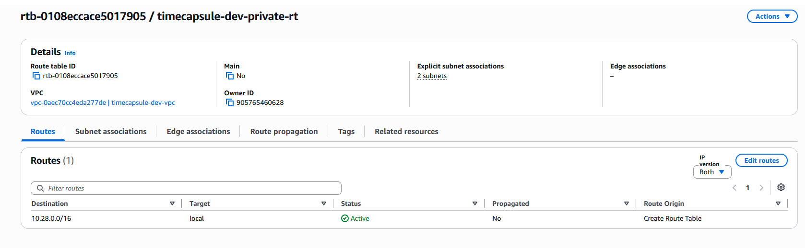  
*private-rt: только локальный маршрут 10.28.0.0/16.*

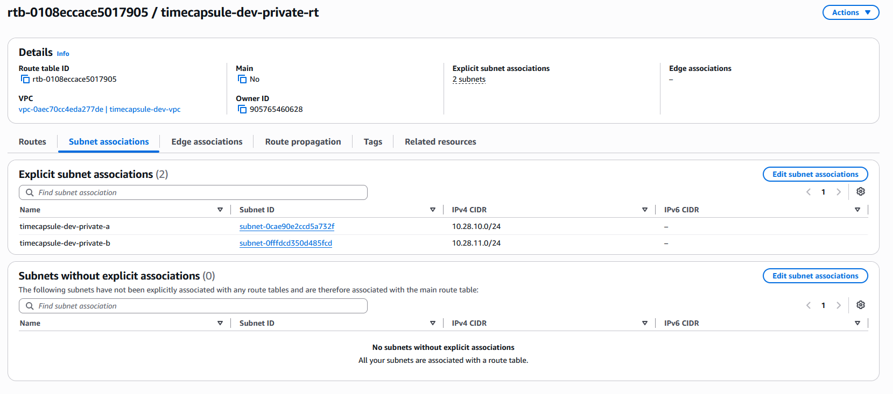  
*private-rt связана с подсетями private-a и private-b.*

**Какой маршрут есть в обеих таблицах, хотя вы его не добавляли? Что он даёт? Куда уйдёт пакет из private-a, адресованный 8.8.8.8?**
В обеих таблицах есть маршрут `10.28.0.0/16 → local`. AWS добавляет его автоматически и не даёт удалить: он позволяет всем подсетям VPC связываться друг с другом, в том числе между разными зонами доступности. Для пакета из private-a на 8.8.8.8 в private-rt нет подходящего маршрута (8.8.8.8 не входит в 10.28.0.0/16, а маршрута 0.0.0.0/0 нет), поэтому пакет никуда не уйдёт и будет отброшен.

### Задание 4. Security Group

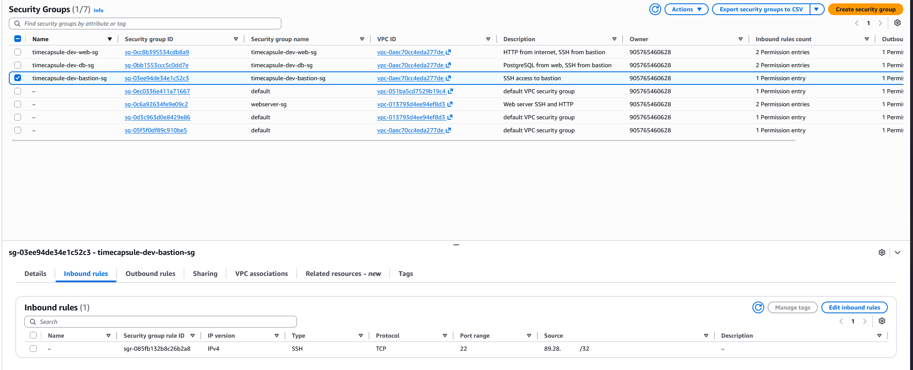  
*bastion-sg: SSH (22) только с моего IP.*

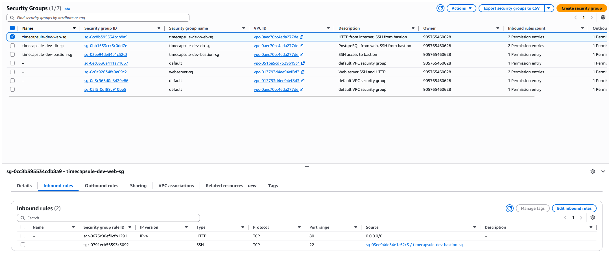  
*web-sg: HTTP (80) отовсюду, SSH (22) только от bastion-sg.*

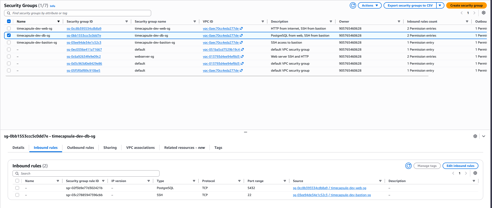  
*db-sg: PostgreSQL (5432) только от web-sg, SSH (22) только от bastion-sg.*

**Почему в db-sg источником указана группа web-sg, а не адрес веб-сервера или диапазон 10.28.0.0/16?**
Источник-группа означает «любой экземпляр, к которому привязана web-sg», независимо от его адреса. Если веб-сервер пересоздадут или добавят второй, правило продолжит работать без изменений, а с конкретным IP его пришлось бы править. Диапазон 10.28.0.0/16 открыл бы базу для всех серверов VPC, включая bastion, что нарушает принцип минимальных привилегий.

### Задание 5. Экземпляры

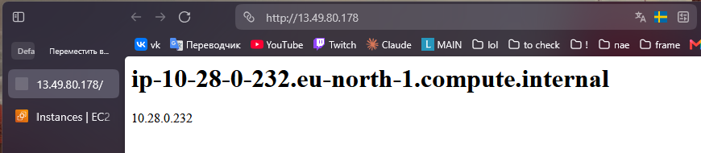  
*Страница web-server по публичному IP: имя сервера и приватный адрес из 10.28.0.0/24.*

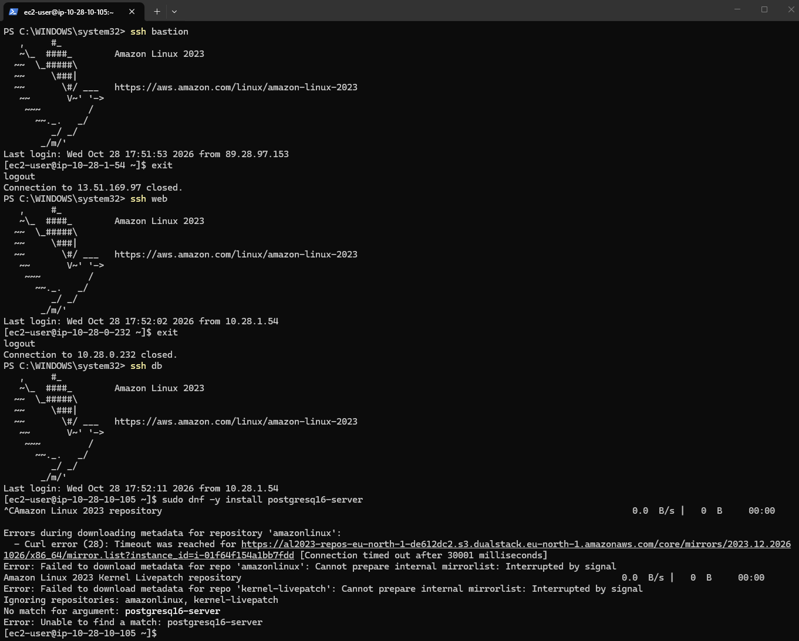  
*`sudo dnf -y install postgresql16-server` на db-server зависает: выхода в интернет нет.*

**Почему db-server не может скачать пакеты, хотя web-server это делает? Что нужно добавить в сеть?**
db-server находится в private-a: в private-rt нет маршрута 0.0.0.0/0, и у сервера нет публичного адреса, поэтому пакеты к репозиториям в интернете никуда не уходят. web-server стоит в public-a с маршрутом в Internet Gateway и публичным IP. Чтобы db-server мог скачивать пакеты и при этом оставался недоступным снаружи, нужен NAT Gateway в публичной подсети и маршрут 0.0.0.0/0 на него в private-rt: NAT пропускает исходящие соединения и ответы на них, но не принимает новые соединения из интернета.

### Задание 6. Временный NAT Gateway

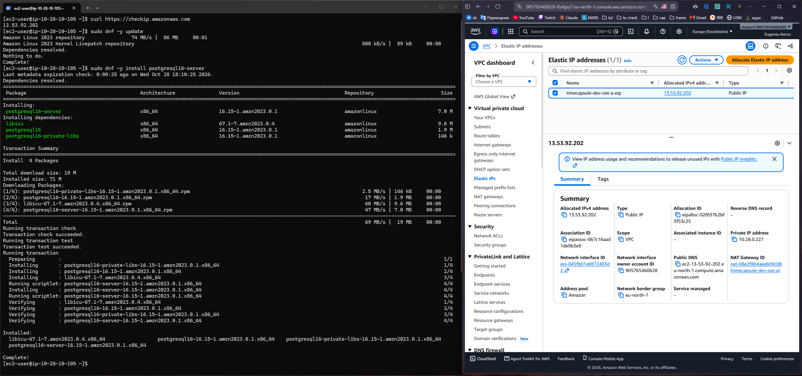  
*`curl https://checkip.amazonaws.com` на db-server возвращает Elastic IP NAT Gateway.*

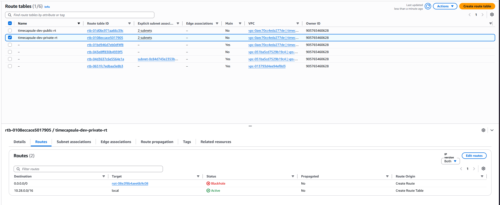  
*Маршрут 0.0.0.0/0 в private-rt в состоянии Blackhole после удаления NAT Gateway.*

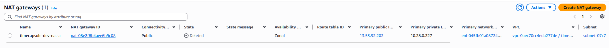  
*NAT Gateway timecapsule-dev-nat-a в состоянии Deleted.*

Маршрут в Blackhole после скриншота удалён, Elastic IP шлюза освобождён.

**Какой адрес вернула первая команда? Почему это не адрес db-server?**
Команда вернула `13.53.92.202` — это Elastic IP NAT Gateway (timecapsule-dev-nat-a-eip), адреса совпадают. У db-server нет публичного адреса, только приватный 10.28.10.x, который в интернете не маршрутизируется. NAT Gateway подменяет адрес отправителя в исходящих пакетах на свой Elastic IP, поэтому внешний сервис видит адрес шлюза.

**Доступ к базе ограничивают три механизма. Что делает каждый? Что будет, если ошибиться только в одном?**
1. Отсутствие публичного адреса и маршрута в Internet Gateway: пакет из интернета просто не может дойти до db-server, адреса для него нет.
2. Security Group db-sg: даже внутри VPC порт 5432 открыт только для серверов с web-sg.
3. pg_hba.conf: сам PostgreSQL пускает только с адресов 10.28.0.0/24 и только с верным паролем.

Это эшелонированная защита: если ошибиться в одном механизме, например открыть 5432 для всей VPC в db-sg, база всё ещё защищена двумя другими. Сломать её можно, только если ошибки окажутся во всех слоях сразу.

**Почему PostgreSQL продолжает работать после удаления NAT Gateway? Что делать для обновлений безопасности?**
NAT нужен только для исходящих соединений db-server в интернет. Пакеты уже установлены на диск, а приложение подключается к базе по локальному маршруту VPC, который от NAT не зависит. Для обновлений придётся снова временно создать NAT Gateway, добавить маршрут, выполнить `dnf update`, затем удалить шлюз, маршрут и Elastic IP.

### Задание 7. Проверки

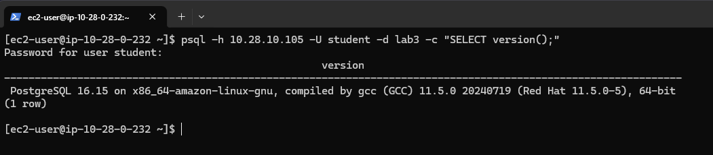  
*Подключение к базе lab3 с web-server: `SELECT version();` возвращает версию PostgreSQL 16.*

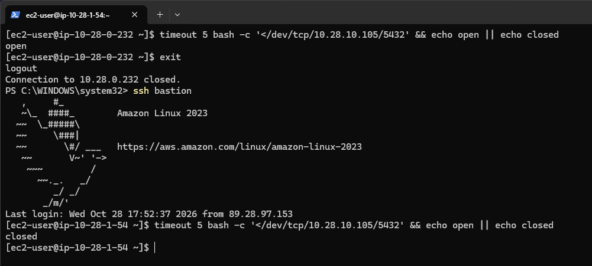  
*Порт 5432 db-server: с web-server — open, с bastion — closed.*

**Почему с web-server порт открыт, а с bastion нет, хотя маршрут между ними есть?**
Маршрут только определяет, куда пакет может дойти, а решение, пустить ли его, принимает Security Group. В db-sg порт 5432 открыт только для источника web-sg. У web-server эта группа есть, у bastion — только bastion-sg, поэтому его пакеты на 5432 отбрасываются.

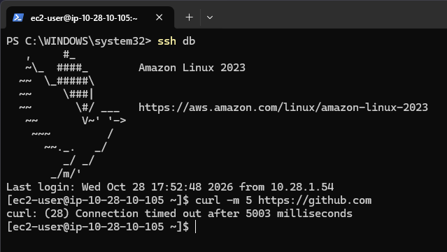  
*`curl -m 5 https://github.com` с db-server завершается по таймауту.*

**Почему запрос не проходит? Можно ли из интернета подключиться к 5432 db-server?**
NAT Gateway удалён, в private-rt нет маршрута 0.0.0.0/0, поэтому исходящий пакет некуда отправить. Подключиться из интернета тоже нельзя: по цепочке «маршрут → адрес → фильтры» у private-a нет маршрута в Internet Gateway, у db-server нет публичного адреса, а даже внутри VPC порт закрыт db-sg и ограничен pg_hba.conf.

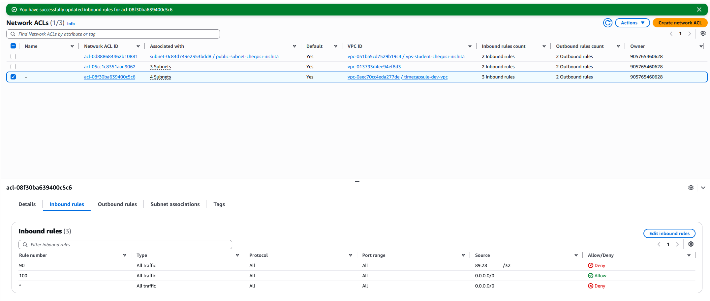  
*Правило 90 в Network ACL: Deny All traffic с моего IP.*

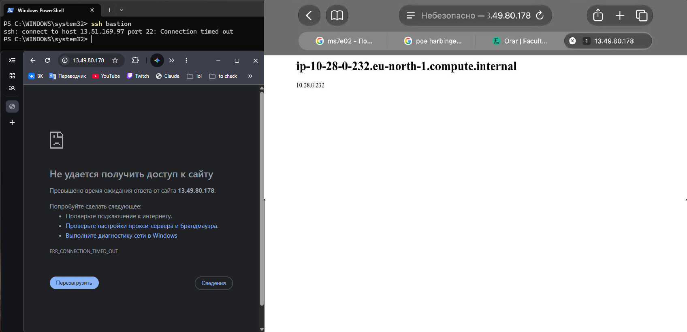  
*SSH на bastion и сайт с моего IP не работают, с телефона через мобильный интернет сайт открывается.*

**Почему заблокировано и SSH, и сайт? Почему с телефона сайт открывается? Почему номер меньше 100?**
Network ACL работает на границе подсети, до Security Group: пакет с моего адреса отбрасывается раньше, чем Security Group вообще его увидит, поэтому заблокирован весь трафик — и SSH, и HTTP. У телефона в мобильной сети другой внешний IP, под правило он не попадает. Правила Network ACL проверяются по возрастанию номера до первого совпадения, а в ACL по умолчанию есть правило 100 «Allow all». Правило с номером больше 100 никогда бы не сработало.

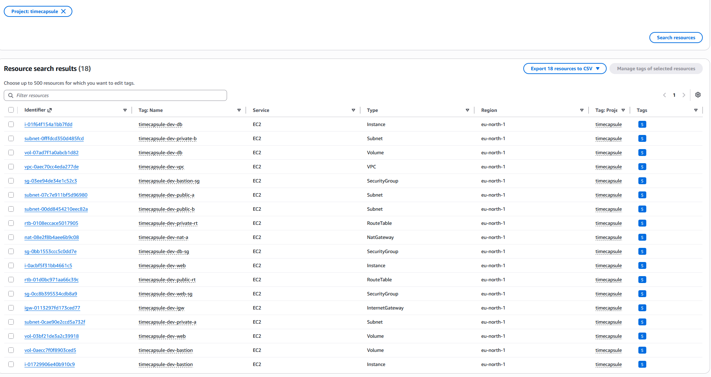  
*Tag Editor: все ресурсы с тегом Project = timecapsule.*

**Как по тегам найти ресурсы для удаления? Зачем тег Owner в личном аккаунте?**
В Tag Editor выбрать регион, все типы ресурсов и фильтр `Project = timecapsule` (или `Lab = lab3`): в списке окажутся все ресурсы проекта, включая диски. Тег Owner в личном аккаунте нужен по привычке и для будущего: в рабочем аккаунте ресурсы создают многие люди, и Owner показывает, кого спрашивать о ресурсе. Кроме того, соглашение должно быть одинаковым везде, чтобы автоматические проверки и отчёты по расходам работали без исключений.

---

## Часть 2. Продвинутый уровень

### Задание 8. Перенос сервера ЛР2 в новую сеть

**Что содержит образ? Какие данные из ЛР2 оказались на app-server? Где сейчас хранится база?**
Образ — это снимок корневого диска webserver и описание запуска. На app-server без установки оказалось всё содержимое диска: Amazon Linux с nginx, PHP-FPM и PostgreSQL, код приложения в /var/www/timecapsule, `.env`, библиотеки vendor, загруженные файлы в storage/uploads и сама база ЛР2 со всеми пользователями и капсулами. Пока что база по-прежнему работает локально на app-server (localhost).

### Задание 9. Elastic IP

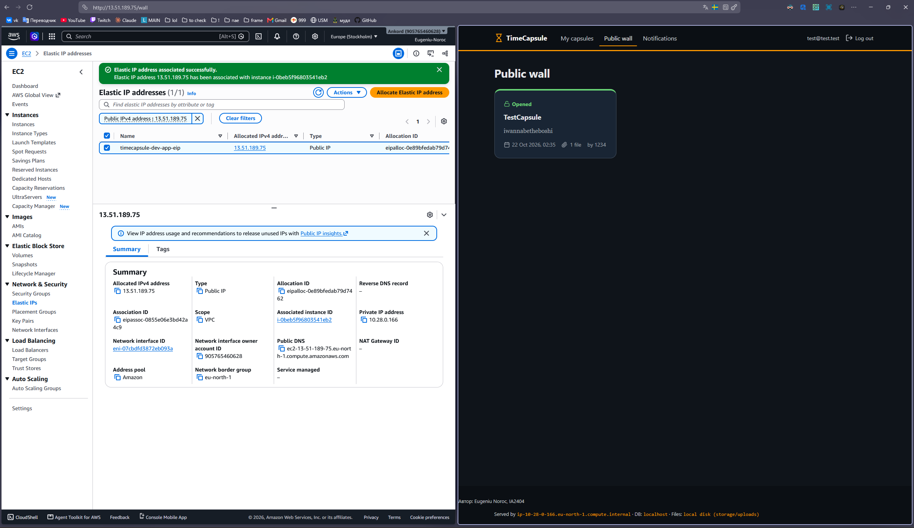  
*Приложение TimeCapsule открывается по Elastic IP, выполнен вход под пользователем из ЛР2.*

**Почему Elastic IP нужен app-server, но не bastion? Сколько он стоит у остановленного сервера? Понадобится ли он с балансировщиком?**
По адресу app-server заходят пользователи, и он прописан в `APP_URL`, поэтому адрес должен быть постоянным. Адрес bastion нужен только мне, и обновить строку в `~/.ssh/config` проще, чем платить за постоянный адрес. Elastic IP стоит $0,005 в час всегда, даже у остановленного сервера: AWS берёт плату за то, что адрес закреплён за аккаунтом и недоступен другим. С балансировщиком нагрузки Elastic IP не понадобится: пользователи будут обращаться к DNS-имени балансировщика, а серверы смогут стоять в приватных подсетях.

### Задание 10. База данных приложения на db-server

**Зачем для базы нужен новый сильный пароль, если порт 5432 и так закрыт Security Group?**
Security Group — лишь один слой защиты. Если правило по ошибке откроют шире, или злоумышленник получит доступ к app-server, между ним и данными останется только пароль. Старый пароль из ЛР2 уже лежал в `.env` и в образе, поэтому новый исключает его повторное использование.

### Задание 11. Приватная зона Route 53

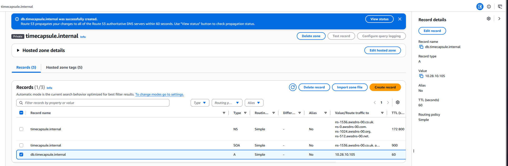  
*Запись A `db.timecapsule.internal` в приватной зоне указывает на приватный IP db-server.*

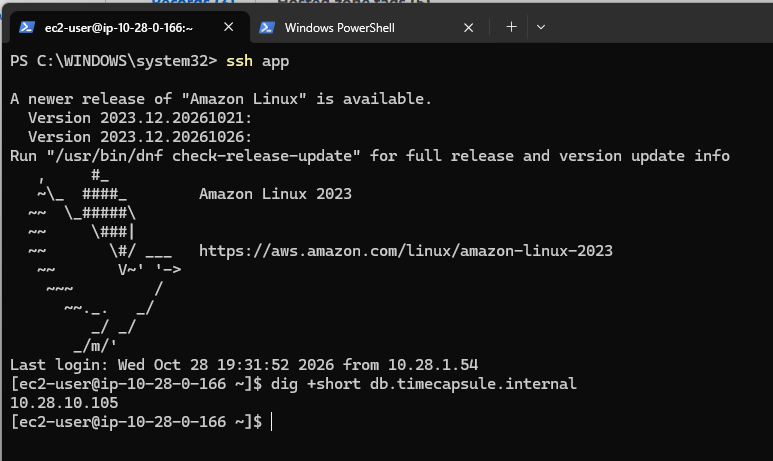  
*`dig +short db.timecapsule.internal` с app-server возвращает 10.28.10.x.*

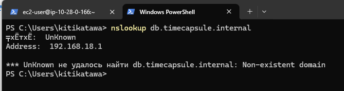  
*`nslookup db.timecapsule.internal` с моего компьютера: имя не найдено.*

**Почему с app-server имя находится, а с компьютера нет? Что изменить, если db-server пересоздадут?**
Приватная зона связана только с timecapsule-dev-vpc, и отвечает на запросы только DNS-сервер внутри этой VPC (адрес .2). Мой компьютер спрашивает публичные DNS-серверы, а они о зоне timecapsule.internal ничего не знают. Если db-server пересоздадут, достаточно изменить IP в записи A — `.env` на app-server менять не придётся.

### Задание 12. Перенос данных и переключение приложения

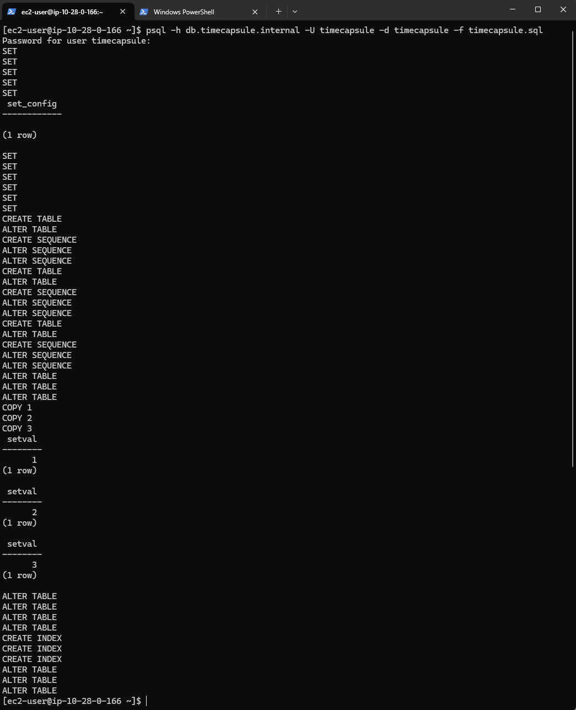  
*`psql -h db.timecapsule.internal ... -f timecapsule.sql` загружает таблицы и строки в новую базу.*

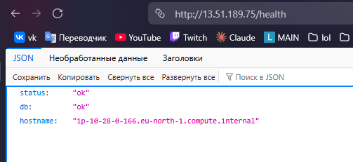  
*`/health` после переключения: `"db":"ok"`.*

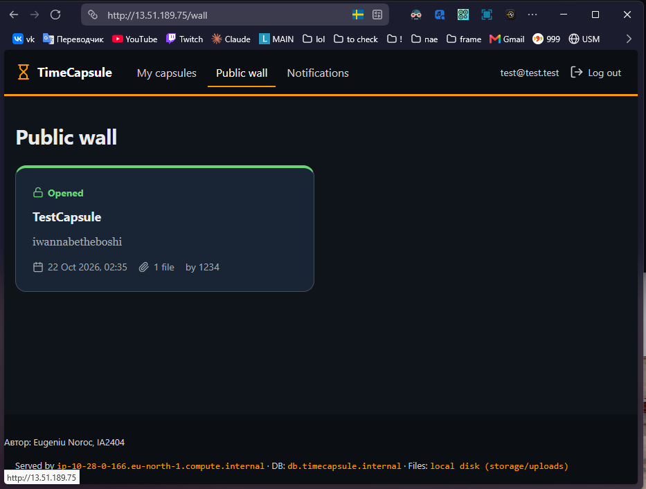  
*Капсулы, созданные в ЛР2, на месте после переноса базы.*

**Где лежат прикреплённые файлы? Что с ними будет, если удалить app-server?**
Файлы лежат на корневом диске EBS app-server в /var/www/timecapsule/storage/uploads: они переехали вместе с образом, а в базе хранятся только ссылки на них. Если удалить app-server, диск удалится вместе с ним, и все файлы пропадут, хотя записи о капсулах в базе на db-server останутся. Решение — хранить файлы в отдельном сервисе, например S3.

### Задание 13. Деплой и обслуживание

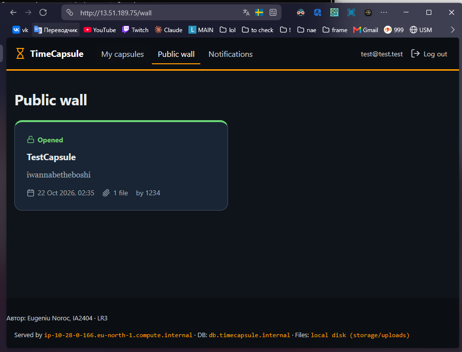  
*Новая версия с отметкой «LR3» в подвале, выпущенная через bastion.*

**Почему в командах деплоя ничего менять не пришлось?**
Команды деплоя работают на самом сервере и не зависят от того, как я к нему подключаюсь. Путь через bastion описан в `~/.ssh/config` (ProxyJump), поэтому `ssh app` выглядит так же просто, как раньше. Адрес базы приложение берёт из `.env`, а его деплой не трогает.

`/health` при остановленном db-server: `"db":"error"`.

**Что показал /health и почему? Изменился ли приватный адрес db-server?**
`/health` вернул `"db":"error"`, а главная страница — ошибку: PHP-FPM работает, но не может подключиться к db.timecapsule.internal. После запуска db-server приложение заработало само, ничего менять не пришлось: приватный адрес экземпляра сохраняется при остановке и запуске, меняется только публичный.

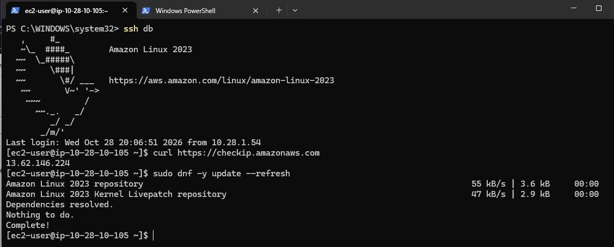  
*`sudo dnf -y update --refresh` на db-server через временный NAT Gateway: метаданные репозиториев загружены заново, `checkip` показывает адрес нового NAT.*

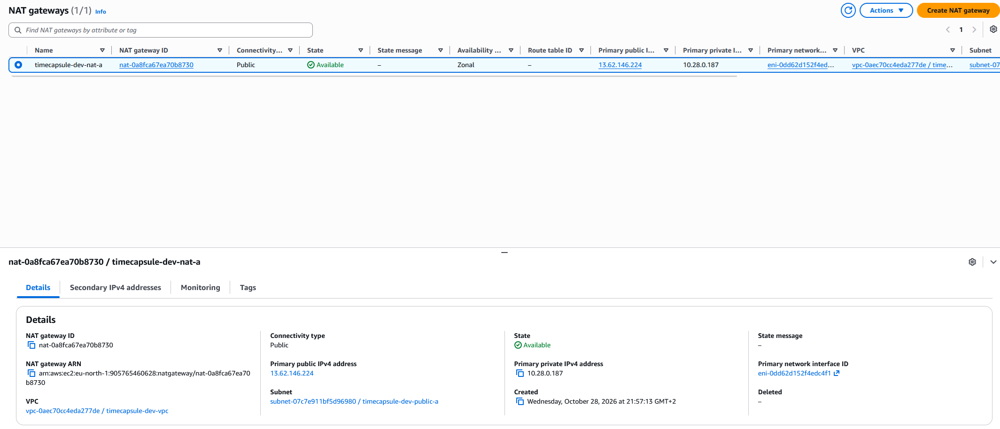  
*Временный NAT Gateway timecapsule-dev-nat-a в состоянии Available на время обновления; после `dnf update` шлюз, маршрут и его Elastic IP удалены.*

---

## Задание 14. Архитектура и решение

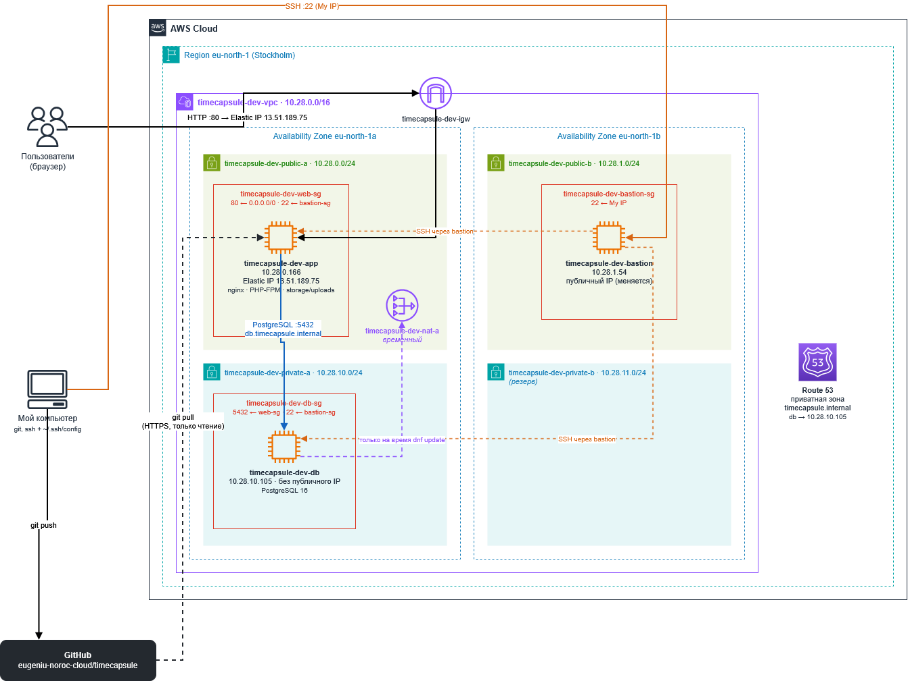  
*Сеть timecapsule-dev-vpc в регионе eu-north-1: две зоны, четыре подсети, bastion, app-server, db-server, приватная зона Route 53 и временный NAT Gateway.*

ADR: [docs/adr/0002-database-placement.md](../docs/adr/0002-database-placement.md)  

---

## Итог

Экземпляры bastion, app-server и db-server остановлены, временный web-server из Части 1 завершён, образ `timecapsule-dev-app-lab2` и его снимок удалены.

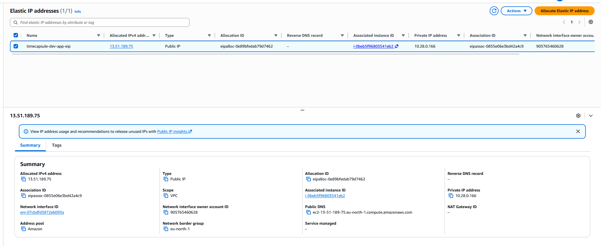  
*После завершения работы остался только Elastic IP app-server.*

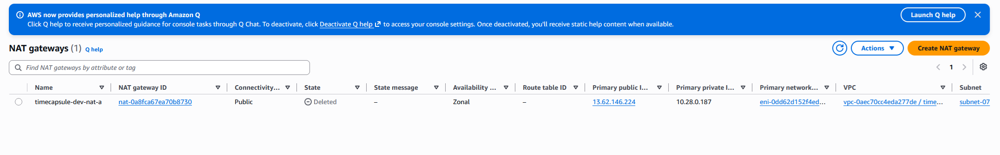  
*Нет NAT Gateway в состоянии Available.*

---

## Ответы на контрольные вопросы

**1. Как проходит запрос от браузера до базы данных? Какие маршруты и фильтры он проходит?**
Браузер обращается к Elastic IP app-server. Internet Gateway переводит публичный адрес в приватный, пакет проходит Network ACL подсети public-a и Security Group web-sg (порт 80 открыт для всех) и попадает в nginx, а оттуда в PHP-FPM. Приложение получает адрес db.timecapsule.internal из приватной зоны Route 53 и подключается к db-server по локальному маршруту 10.28.0.0/16. На стороне базы пакет проходит Network ACL private-a, Security Group db-sg (5432 только от web-sg) и pg_hba.conf (только пользователь timecapsule из 10.28.0.0/24 с паролем).

**2. Злоумышленник знает приватный IP db-server. Что ему нужно, чтобы подключиться к базе?**
Одного адреса недостаточно: из интернета до приватного адреса нет маршрута. Ему нужно попасть внутрь VPC, причём на сервер с группой web-sg, то есть взломать app-server, и затем знать пароль пользователя timecapsule. Либо получить доступ к аккаунту AWS и изменить сеть, поэтому важна защита учётных записей.

**3. Чем временный NAT Gateway лучше постоянного? Какие неудобства он создаёт?**
Временный шлюз стоит центы вместо примерно $1,25 в сутки и большую часть времени не оставляет db-server никакого пути в интернет, что уменьшает поверхность атаки. Неудобство в том, что обновления не ставятся автоматически: для каждого обновления нужно вручную создавать шлюз, маршрут и Elastic IP, а потом не забыть их удалить, иначе придут расходы.

**4. Как изменится схема, если приложение должно пережить отказ зоны eu-north-1a? Чего не хватает?**
Сейчас app-server и db-server стоят в одной зоне, и её отказ останавливает приложение. Нужен второй app-server в public-b, балансировщик нагрузки перед обоими серверами, реплика базы в private-b с автоматическим переключением (например, Amazon RDS Multi-AZ) и общее хранилище файлов вместо локального диска (S3 или EFS). Для обновлений базы во второй зоне понадобился бы и NAT Gateway в зоне b.

---

## Использованные источники

- Лекция 5 «Виртуальные сети в облаке. Amazon VPC», Hands-on 5.1
- [Документация Amazon VPC](https://docs.aws.amazon.com/vpc/)
- [Amazon Route 53: private hosted zones](https://docs.aws.amazon.com/Route53/latest/DeveloperGuide/hosted-zones-private.html)
